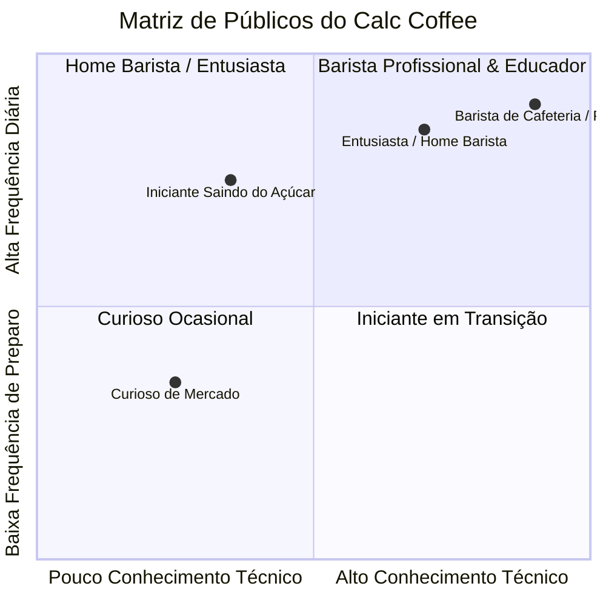

# Product Requirements Document (PRD) — Calc Coffee (v2.3.0)
## Estudo de Descoberta de Produto, Mapeamento de Mercado & Estratégia de Monetização

---

## 1. Visão Geral & Modelo Societário

* **Produto:** *Calc Coffee* — Copiloto do Barista, Calculadora de Extração Sensorial e Cronômetro de Bancada com Motor IA de Diagnóstico e Comércio Contextual.
* **Proposta de Valor Central:** Transformar qualquer pessoa que compra um café especial em grãos ou moído em um barista consistente em casa, eliminando a frustração da xícara amarga, ácida ou sem graça através de precisão matemática, áudio de bancada e inteligência sensorial.
* **Liderança & Governança:**
  * **Gustavo (Bene):** Arquiteto Agêntico e Líder Técnico. Responsável pela infraestrutura do software, UX mobile, modelo de dados, engenharia de prompts/IA e esteira CI/CD.
  * **Eduardo:** Líder de Domínio & Comunidade. Especialista prático em métodos de barismo, calibração sensorial, validação de receitas e articulador do canal de distribuição (comunidade *Coffee Lovers* e cafeterias parceiras).

---

## 2. Diagnóstico de Mercado & Tendências (BSCA, TikTok, Google Trends)

### 2.1 O Boom do Café Especial no Brasil
* **Crescimento Anual:** De acordo com a **BSCA (Associação Brasileira de Cafés Especiais)** e a **ABIC**, o consumo de cafés especiais e gourmets no Brasil cresce a uma taxa média de **15% ao ano**, já respondendo por cerca de **10% de todo o consumo interno nacional** (um mercado de mais de 21 milhões de sacas anuais).
* **Fenômeno das Redes Sociais (TikTok, Instagram Reels e YouTube):**
  * A estética do **"Barista Caseiro" (*Home Barista*)** explodiu. Vídeos em formato ASMR com chaleira bico de ganso, moagem de grãos em moedores manuais e filtros Hario V60 acumulam dezenas de milhões de visualizações.
  * A frase mais comum entre novos adeptos: *"Aprendi a tomar café sem açúcar e agora não consigo voltar para o tradicional queimado"*.

### 2.2 A Grande Dor Não Resolvida do Mercado
1. O consumidor é convencido nas redes sociais a gastar de **R$ 35 a R$ 85 em um pacote de 250g de café especial**.
2. Chegando na cozinha, ele usa uma proporção aleatória de água (geralmente água fervendo a 100°C) e pó não pesado.
3. O resultado na xícara fica **amargo, adstringente ou aguado**, gerando arrependimento de compra.
4. **Oportunidade do Calc Coffee:** Ser o copiloto de bolso que assegura que o investimento do usuário em um café caro entregue a xícara prometida na embalagem.

---

## 3. Personas & Segmentação de Público

### Persona 1: O "Iniciante em Transição" (Foco de Volume / Topo de Funil)
* **Perfil:** Pessoa comum que comprou café gourmet/especial no supermercado ou cafeteria e quer aprender a preparar sem açúcar.
* **Equipamento:** Coador Melitta comum ou prensa francesa barata, sem balança (mede em colheres de sopa e canecas).
* **Principal Dor:** *"Meu café fica fraco ou amargo demais, não sinto as notas de chocolate/frutas que estavam escritas no pacote"*.
* **O que busca no app:** Modo simples, rápido, sem jargões pretensiosos, que diga quanto de água colocar para cada colher de pó.

### Persona 2: O "Home Barista / Entusiasta" (Foco de Retenção & Conversão)
* **Perfil:** Apaixonado pelo ritual do café. Possui moedor manual (Timemore C2/C3, Kingrinder), Hario V60, chaleira bico de ganso e balança digital com timer.
* **Comportamento:** Acompanha receitas de campeões (Tetsu Kasuya, Boram Um, James Hoffmann) e busca consistência diária.
* **Principal Dor:** Dificuldade em repetir a mesma extração perfeita todos os dias e falta de um cronômetro com áudio que não force a olhar para o celular com a mão na chaleira.
* **O que busca no app:** Roteiro de despejos com áudio neural, Wake Lock (tela não apaga) e o Copiloto IA (Dial-in Coach) para ajustar a moagem quando a xícara sai desequilibrada.

### Persona 3: O "Barista Profissional / Dono de Cafeteria" (Foco B2B / Parcerias)
* **Perfil:** Opera no balcão de cafés especiais, ministra cursos ou lidera equipes de atendimento.
* **Principal Dor:** Treinar novos baristas e padronizar as fichas técnicas de extração de cada grão da casa.
* **O que busca no app:** Ferramenta ágil de demonstração para alunos e recomendação oficial para os clientes da cafeteria baixarem e reproduzirem o café em casa.

---

## 4. Análise de Viabilidade das Formas de Monetização

| Modelo | Viabilidade no Brasil | Potencial de Receita | Nível de Fricção para o Usuário | Recomendação Estratégica |
| :--- | :---: | :---: | :---: | :--- |
| **1. Assinatura Mensal Pura ($/mês)** | 🔴 Baixa | Baixo (Churn Alto) | Alto | **Não recomendada como barreira inicial.** Cobrar R$ 15 a 20/mês para usar o timer básico causa abandono imediato para apps gratuitos. |
| **2. Modelo Freemium (Gratuito + Pro Anual/Vitalício)** | 🟢 Alta | Médio-Alto | Baixo | **Recomendada para Fase 2.** Base gratuita atrativa; camada PRO (R$ 49,90 vitalício ou R$ 5,90/mês) para histórico ilimitado, receitas exclusivas e guia de cliques de moedores. |
| **3. Afiliação Contextual Inteligente (Amazon/Shopee/Afiliados)** | 🟢 Altíssima | Alto (Margem Líquida) | Zero | **Melhor modelo imediato.** Sugerir equipamentos certos na hora exata da queixa de sabor (ex: moedor de mós de aço quando o café sai amargo). |
| **4. Comissões por Novos Assinantes de Clubes de Café (CPA)** | 🟢 Alta | Alto (R$ 30 a R$ 60/lead) | Zero | **Altamente viável com o canal do Eduardo.** Parcerias com clubes consolidados (Coffee & Joy, Moka Clube, etc.) gerando cupons de desconto rastreáveis. |
| **5. Marketplace Direto de Microlotes (Eduardo & Torrefações)** | 🟡 Média (Fase 3) | Altíssimo a longo prazo | Baixo | Viável após consolidação da base de usuários, operando como revenda com margem de 15% a 25% por pacote enviado diretamente pelo produtor parceiro. |

---

## 5. Willingness-to-Pay (Disposição a Pagar) & Benchmark de Preços

### Benchmark Concorrente Global:
* **Filtru Pro:** \$3,49/mês (~R$ 20/mês) ou \$32,99/ano (~R$ 190/ano) ou \$79,99 vitalício. (Considerado caro para o mercado brasileiro, restringindo a usuários de iPhone de alta renda).
* **Coffee Guru:** Gratuito com anúncios invasivos que quebram a experiência do ritual de bancada.
* **Beanconqueror:** Open-source, excelente para registro técnico de TDS, mas com interface complexa e sem orientação de voz amigável para iniciantes.

### Estrutura de Preço Ideal para o Brasil (Se optar pelo Calc Coffee Pro):
* **Assinatura Mensal:** R$ 6,90 / mês (menor que o preço de 1 expresso em cafeteria de especialidade).
* **Assinatura Anual:** R$ 49,90 / ano (equivalente a R$ 4,15/mês, com desconto perceptível).
* **Acesso Vitalício (*Lifetime* - Queridinho do público tech/barista):** R$ 79,90 em pagamento único.

---

## 6. Funcionalidades Diferenciais do Calc Coffee

1. **Calculadora Cruzada de Massa com Fator de Retenção (`2.0x`):** Considera a absorção real da água pelo pó, garantindo o volume exato na xícara.
2. **Cronômetro Hands-Free com Voz Neural & Sino Acústico Zen:** Permite operar a chaleira sem desviar o olhar para a tela.
3. **Copiloto IA Sensorial (Dial-in Coach):** Diagnostica sobre-extração (amargor/adstringência), sub-extração (acidez/corpo ralo) e canalização, fornecendo a correção imediata para o próximo preparo.
4. **Arquitetura 100% Offline-First:** Opera em sítios, fazendas de café e cozinhas sem conexão com a internet.
5. **APK Nativo Leve (4.11 MB) com Wake Lock:** Não consome armazenamento e mantém a tela do celular acesa durante todo o preparo.
