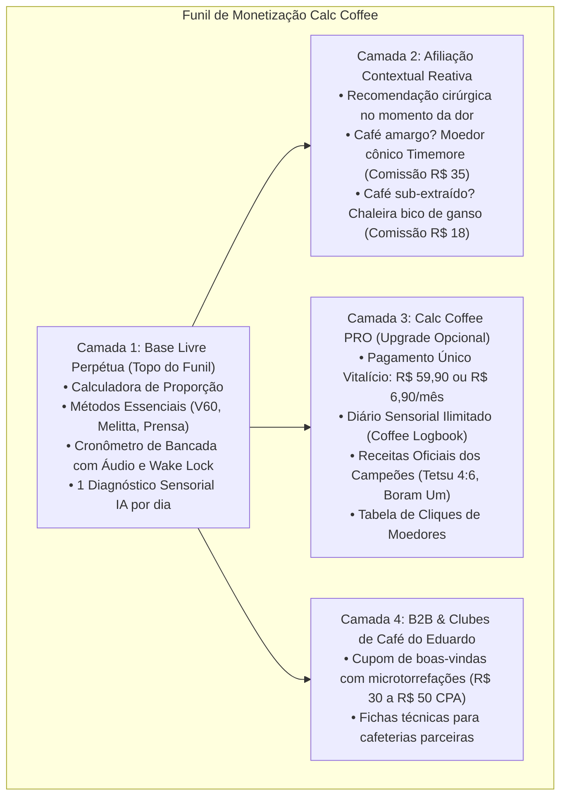

# ☕ DOSSIÊ ESTRATÉGICO DE MERCADO & MONETIZAÇÃO
## Calc Coffee — Resposta Executiva à Proposta do Eduardo & Estudo de Viabilidade Econômica

---

### 📌 1. A Pergunta do Eduardo (Áudio WhatsApp de 09/11/2026)

> *"E outra coisa... você acha que... a gente faz os testes, né, mas pensando já em monetizar o app depois: você acha que a gente deixa ele numa versão toda aberta, tipo tudo free mesmo e buscar ganhar em cima dessas compras de afiliado, por indicação, esses links com comissão? Ou criar um valor para o app, tipo criar um tempo trial, alguma coisa assim, e um valor fixo para o app? Daí quem testa passa um tempinho testando, e se gostou, ele começa meio que a bloquear algumas partes... O que você acha pensando na parte de ganhar dinheiro?"*

---

### 📊 2. Raio-X do Mercado Brasileiro de Café Especial (Dados Reais 2024–2026)

Para responder com precisão matemática e visão de negócios, analisamos os dados da **BSCA (Associação Brasileira de Cafés Especiais)**, **ABIC** e a febre de consumo nas redes sociais (**TikTok e Instagram Reels**):

1. **Crescimento Explosivo de 15% ao Ano:** Enquanto o café tradicional estagnou pelo impacto da inflação, o consumo interno de **cafés especiais (100% arábica com notas sensoriais)** cresce dois dígitos ao ano e já representa **quase 10% de todo o consumo nacional** (mais de 2 milhões de sacas consumidas internamente).
2. **O Fenômeno do "Barista Caseiro" no TikTok:**
   - Vídeos de rituais matinais no estilo **ASMR** (moagem na hora, água vertendo no Hario V60 e xícaras de vidro duplo) acumulam centenas de milhões de visualizações.
   - O público iniciante busca ativamente: *"como tomar café sem açúcar"*, *"qual o melhor moedor barato"* e *"proporção de café para água"*.
3. **O Maior Ponto de Frustração do Consumidor:**
   - A pessoa compra um pacote de café especial por **R$ 45 a R$ 80 (250g)**.
   - Chega em casa, joga água fervendo a 100°C sobre um pó mal dosado e o café fica **amargo, adstringente ou ralo**.
   - **Oportunidade do Calc Coffee:** O aplicativo é o "seguro" de que o café caro que a pessoa comprou vai ficar gostoso na xícara.

---

### ⚖️ 3. Análise Crítica dos Dois Caminhos Propostos pelo Eduardo

#### 🟢 Caminho A: 100% Gratuito Financiado por Afiliação / Comissões
* **Como funcionaria:** O usuário tem acesso total e livre. Ao utilizar o Copiloto IA ou navegar pelas receitas, o app recomenda moedores, chaleiras, balanças e cafés parceiros com links de afiliados (Amazon, Mercado Livre, Shopee ou torrefações).
* **Vantagens:**
  - **Fricção Zero:** Qualquer barista, amigo ou seguidor da comunidade do Eduardo baixa sem pensar duas vezes.
  - **Boca a Boca Rápido:** Escolas de barismo e cafeterias indicam o app para seus clientes sem receio de parecerem "vendedoras de software".
  - **Ticket Médio Alto:** Moedores de entrada populares (Timemore C2/C3, Kingrinder) custam entre R$ 250 e R$ 420. Comissões de 7% a 10% geram **R$ 20 a R$ 40 limpos por venda**, sem estoque, sem risco de frete e sem SAC.
* **Riscos / Desvantagens:**
  - O usuário não compra equipamentos todos os meses (compra uma chaleira e usa por 3 anos). A receita depende de novos entrantes contínuos.

#### 🔴 Caminho B: Trial Gratuito (Tempo Limitado) + Bloqueio / Valor Fixo (Paywall Puro)
* **Como funcionaria:** O usuário usa 7 a 14 dias grátis. Depois disso, o app bloqueia o cronômetro ou as receitas até que ele pague uma taxa fixa ou mensalidade.
* **Benchmark Mundial (O Caso do Filtru Pro):**
  - O app **Filtru** (líder na App Store americana) cobra **US$ 3,49/mês (~R$ 20/mês)** ou **US$ 32,99/ano (~R$ 190/ano)**.
  - *Resultado no Brasil:* Alta rejeição. No Brasil, cobrar mensalidade para um cronômetro e calculadora básica faz o usuário desinstalar e usar o cronômetro do próprio celular ou vídeos do YouTube.
* **Riscos / Desvantagens:**
  - Mata o crescimento orgânico no ninho. O barista de balcão não vai recomendar aos clientes um app que para de funcionar em 7 dias.

---

### 🏆 4. A Estratégia Vencedora: O Modelo Híbrido "Freemium 3D"

A melhor forma de **ganhar dinheiro de verdade sem travar o crescimento** não é escolher entre A ou B, mas combinar o melhor dos dois mundos em um **funil de 3 camadas**:

#### Regra de Ouro do Bloqueio:
> **NUNCA bloqueie a calculadora nem o cronômetro básico.**  
> O que se bloqueia no plano PRO são as ferramentas de **colecionismo e maestria**: o diário de cafés tomados, os segredos das receitas dos campeões mundiais e diagnósticos ilimitados da IA.

---

### 💰 5. Simulação Financeira Real (Base de 1.000 Usuários Ativos)

Considerando uma comunidade de **1.000 usuários ativos mensais** (perfeitamente alcançável com os canais do Eduardo e redes sociais):

| Canal de Monetização | Conversão Estimada | Ticket / Margem Média | Receita Gerada |
| :--- | :---: | :---: | :---: |
| **1. Comissões de Afiliados (Equipamentos)** | 2.5% ao mês (25 compras de moedores/chaleiras) | R$ 30,00 de comissão líquida | **R$ 750,00 / mês** |
| **2. Calc Coffee PRO (Assinaturas / Vitalício)** | 4.0% da base (40 upgrades a R$ 49,90/ano) | R$ 49,90 por licença anual | **R$ 1.996,00 / ano** (~R$ 166/mês) |
| **3. CPA de Assinatura de Clubes de Café** | 1.5% ao mês (15 novos assinantes em clubes parceiros) | R$ 40,00 de bônus por novo membro | **R$ 600,00 / mês** |
| **TOTAL ESTIMADO (Comunidade Inicial de 1.000 pessoas):** | — | — | **~R$ 1.500 a R$ 2.000 / mês** |

*Nota: Esse faturamento ocorre com **custo operacional praticamente ZERO**, já que o app roda offline no celular e as compilações são gratuitas no GitHub Actions.*

---

### 🚀 6. Roteiro Prático de Execução para Gustavo & Eduardo

1. **Passo 1 (Semana 1 a 3 — Lançamento e Teste Alfa com Baristas):**
   - Entregar o **APK Nativo (4.11 MB com áudio studio)** para 20 a 30 baristas e entusiastas da lista do Eduardo.
   - Deixar 100% gratuito. O foco único é: *"Eles estão usando o app todo dia na hora de fazer café?"*.
2. **Passo 2 (Mês 2 — Ativação de Afiliados Contextuais):**
   - Cadastrar uma conta no programa de associados da Amazon e Shopee.
   - Conectar os links no Copiloto IA (ex: quando o diagnóstico sugerir moedor de mós cônicas, exibir o botão com link rastreado).
3. **Passo 3 (Mês 3 em diante — Lançamento na Play Store com Camada PRO):**
   - Publicar na Google Play Store.
   - Introduzir a opção de **Acesso Vitalício Pro por R$ 59,90 ou R$ 6,90/mês** para desbloquear o Diário de Grãos e o guia avançado de moagem.
   - Fechar os cupons exclusivos de café em grãos com as torrefações parceiras do Eduardo.
